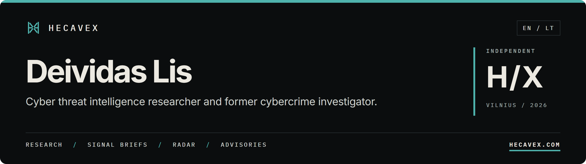
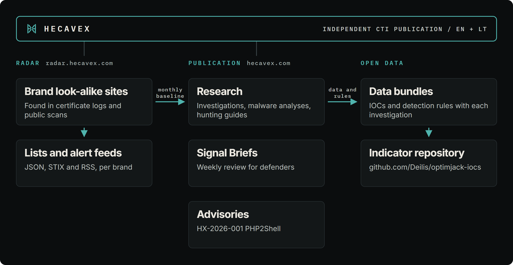

I investigate cybercrime infrastructure, malware and fraud, and publish the results at
**[HECAVEX](https://hecavex.com/en/)**, an independent publication in English and Lithuanian. Before moving to
threat intelligence in 2023 I was a police investigator in Lithuania, most of that time on cybercrime.

**[Research](https://hecavex.com/en/research/)** ·
**[Signal Briefs](https://hecavex.com/en/briefings/)** ·
**[Radar](https://radar.hecavex.com/)** ·
**[About](https://hecavex.com/en/about/)** ·
**[LinkedIn](https://www.linkedin.com/in/deilis)** ·
**[Lietuviškai](https://hecavex.com/lt/)**

## How HECAVEX fits together

| Project | What it is | Where |
| --- | --- | --- |
| **HECAVEX Research** | Investigations, malware analyses and hunting guides. Each one separates evidence from assessment and says where the uncertainty is. | [hecavex.com/en/research](https://hecavex.com/en/research/) |
| **Signal Briefs** | A weekly review of exploited vulnerabilities, incidents and policy changes that defenders should track. | [hecavex.com/en/briefings](https://hecavex.com/en/briefings/) |
| **HECAVEX Radar** | Watches certificate logs and public scans for websites that imitate Lithuanian banks, couriers, shops and public services. Warning signs, not verdicts. | [radar.hecavex.com](https://radar.hecavex.com/) |
| **Radar data for teams** | The same list as downloads and per-brand alert feeds, for blocking and alerting. | [radar.hecavex.com/dataset](https://radar.hecavex.com/dataset/) |
| **Advisories** | Longer PDF advisories. The first is HX-2026-001 on the PHP2Shell runtime flaws. | [PHP2Shell article](https://hecavex.com/en/research/php2shell-php-runtime-rce/) |
| **Indicator repositories** | IOCs and detection rules for a campaign, mirrored here from the article. | [optimjack-iocs](https://github.com/Deilis/optimjack-iocs) |

## Selected research

**Supply chain and malware**

- [OPTIMJACK: Inside track.js, 26 Builds and the Money Trail of the Optimizely Attack](https://hecavex.com/en/research/optimizely-supply-chain-track-js/) (2026). Indicators and rules: [optimjack-iocs](https://github.com/Deilis/optimjack-iocs)
- [Adform Supply Chain Attack: JavaScript Crypto Clipper Analysis](https://hecavex.com/en/research/adform-supply-chain-crypto-clipper/) (2026)
- [FakeGit, AI skills and the download that keeps moving](https://hecavex.com/en/research/fakegit-ai-skills-mutable-downloads/) (2026)
- [Malicious Python on GitHub: Unpacking a Multi-Stage Loader](https://hecavex.com/en/research/github-and-malware/) (2024)

**Phishing and fraud infrastructure**

- [A fine by SMS, a domain a day: the "e-Policija" smishing wave](https://hecavex.com/en/research/epolicija-fine-smishing-domain-a-day/) (2026)
- [UNIPARK Smishing: From One SMS to 126 Phishing Hosts](https://hecavex.com/en/research/unipark-smishing-campaign-infrastructure/) (2026)
- [298 Cloudflare Pages Task Domains and One Stable Phishing Kit](https://hecavex.com/en/research/hostinger-pages-phishing-infrastructure/) (2026)
- [Fake News Investment Scams: Inside the Cloaking and Redirect Infrastructure](https://hecavex.com/en/research/when-fake-news-scams-and-cloaking-meet/) (2026)

**Detection and hunting**

- [PHP2Shell: Exploitation Status and Hunting Rules for the PHP Runtime Flaws](https://hecavex.com/en/research/php2shell-php-runtime-rce/) (2026)
- [Evilginx Detection: Finding Reverse-Proxy Phishing and Session Theft](https://hecavex.com/en/research/evilginx-detection/) (2026)
- [ClickFix Attacks Explained: Fake CAPTCHA, PowerShell and Detection](https://hecavex.com/en/research/clickfix-why-modern-threat-actors-hunt-people/) (2026)
- [T1187 Forced Authentication: Detection and Mitigation for Windows Environments](https://hecavex.com/en/research/t1187-forced-authentication-detection-mitigation/) (2026)

**Method and information operations**

- [Infrastructure Pivoting for CTI: DNS, URLScan, TLS and Hashes](https://hecavex.com/en/research/infrastructure-pivoting-101/) (2026)
- [Analytical Confidence Is a Field, Not a Feeling](https://hecavex.com/en/research/confidence-is-a-field/) (2026)
- [Information Factories on Lithuania's Border](https://hecavex.com/en/research/information-factories-on-lithuanias-border/) (2026)

## How I work

- Evidence comes before the story.
- Confidence and limitations are stated plainly.
- Corrections are documented [in the open](https://hecavex.com/en/corrections/).
- Indicators are written defanged in articles and data files. Only query and rule files carry live values.

The full [editorial standards](https://hecavex.com/en/editorial/) and [methodology](https://hecavex.com/en/methodology/) are on the site.

## What I work on

Tactical and technical threat intelligence · OSINT and infrastructure pivoting · fraud, phishing and social
engineering investigations · detection content (YARA, KQL, Splunk) · Python automation · information operations.

## Speaking and media

I speak at industry events and comment in the media on threat intelligence, fraud infrastructure, identity attacks
and information operations, in English and Lithuanian. Topics and proposed talks are on the
[About page](https://hecavex.com/en/about/#speaking).

## Follow and contact

- Research feed: [hecavex.com/en/feed.xml](https://hecavex.com/en/feed.xml)
- Signal Briefs feed: [hecavex.com/en/briefings/feed.xml](https://hecavex.com/en/briefings/feed.xml)
- [LinkedIn](https://www.linkedin.com/in/deilis)
- [Contact](https://hecavex.com/en/contact/) for research questions, corrections, speaking and media requests
